# 🛒 Azure Databricks Medallion Lakehouse: ShopVista E-Commerce Pipeline

[](https://azure.microsoft.com/)
[](https://databricks.com/)
[](https://spark.apache.org/)
[](https://delta.io/)
[](https://powerbi.microsoft.com/)
[](https://python.org/)
[](https://en.wikipedia.org/wiki/SQL)

An enterprise-grade, end-to-end data engineering solution built on **Azure Databricks** and **Azure Data Lake Storage Gen2 (ADLS Gen2)** using the **Medallion Architecture (Bronze → Silver → Gold)**. The platform ingests batch and streaming transactional data from the **ShopVista** e-commerce system, cleanses and deduplicates records, propagates incremental changes using **Change Data Feed (CDF)**, enforces governance via **Unity Catalog**, and exposes high-performance Star Schema dimensional models for **Power BI DirectQuery** analytics.

---

## 📑 Table of Contents

- [Architectural Overview](#-architectural-overview)
- [Complete Visual Index (All 14 Project Images)](#-complete-visual-index-all-14-project-images)
- [Key Features & Engineering Highlights](#-key-features--engineering-highlights)
- [Repository Structure](#-repository-structure)
- [Data Lake & Storage Architecture](#-data-lake--storage-architecture)
- [Unity Catalog & Governance](#-unity-catalog--governance)
- [Security, Identity & Access Management](#-security-identity--access-management)
- [Medallion Architecture Processing](#-medallion-architecture-processing)
  - [1. Raw & External Volume Setup](#1-raw--external-volume-setup)
  - [2. Bronze Layer (Raw Ingestion)](#2-bronze-layer-raw-ingestion)
  - [3. Silver Layer (Cleansing, Harmonization & CDF)](#3-silver-layer-cleansing-harmonization--cdf)
  - [4. Gold Layer (Star Schema & Business Aggregations)](#4-gold-layer-star-schema--business-aggregations)
- [Workflow Orchestration & DAGs](#-workflow-orchestration--dags)
- [Serving Layer & Power BI Reporting](#-serving-layer--power-bi-reporting)
- [Setup & Deployment Guide](#-setup--deployment-guide)

---

## 🏛️ Architectural Overview

The pipeline processes multi-channel e-commerce activity (web and mobile app) across international geographies (India, United States, United Kingdom, Australia, Canada, UAE, Singapore). It automates raw file ingestion, streaming micro-batches, schema evolution, and daily analytics refreshes.

<p align="center">
  
  <br>
  <em>Figure 1: End-to-End Pipeline Architecture (ShopVista OLTP → ADLS Gen2 → Databricks Unity Catalog → Medallion Layers → Power BI).</em>
</p>

### End-to-End Pipeline Flow

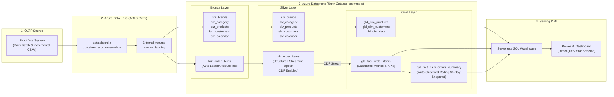

---

## 🖼️ Complete Visual Index (All 14 Project Images)

Every image asset in this folder illustrates a vital phase of the cloud infrastructure, data engineering pipelines, or business intelligence layer:

| # | Image File | Component | What It Illustrates | Section Link |
| :-: | :--- | :--- | :--- | :--- |
| **1** | [`Screenshot 2026-10-16 001011.png`](./Screenshot%202026-10-16%20001011.png) | **System Architecture** | End-to-end pipeline flow from ShopVista OLTP to Power BI | [Architectural Overview](#-architectural-overview) |
| **2** | [`Azure_Data_lake.png`](./Azure_Data_lake.png) | **Azure Storage** | ADLS Gen2 container `ecomm-raw-data` structure & landing directories | [Data Lake Architecture](#-data-lake--storage-architecture) |
| **3** | [`Schema.png`](./Schema.png) | **Unity Catalog** | 3-tier catalog namespace (`ecommers.bronze`, `silver`, `gold`, `raw`) | [Unity Catalog & Governance](#-unity-catalog--governance) |
| **4** | [`Azura_create_user.png`](./Azura_create_user.png) | **Entra ID** | Creating enterprise organization users in Microsoft Azure Portal | [Security & Access Management](#-security-identity--access-management) |
| **5** | [`Users.png`](./Users.png) | **User Directory** | Identity mapping for Data Analysts (DA) & Data Engineers (DE) | [Security & Access Management](#-security-identity--access-management) |
| **6** | [`Users_2.png`](./Users_2.png) | **Databricks Users** | Databricks workspace assigned user list synced with Entra ID | [Security & Access Management](#-security-identity--access-management) |
| **7** | [`Groups.png`](./Groups.png) | **Databricks RBAC** | Workspace role groups (`admins`, `Data analytics`, `Data Engineer`, `users`) | [Security & Access Management](#-security-identity--access-management) |
| **8** | [`Daily_job.png`](./Daily_job.png) | **Databricks Workflows** | Master parent DAG orchestrating `dim_job` → `fact_job` | [Workflow Orchestration & DAGs](#-workflow-orchestration--dags) |
| **9** | [`Daily_refresh_dim_job.png`](./Daily_refresh_dim_job.png) | **Databricks Workflows** | Dimension refresh DAG (`dim_bronze` → `dim_silver` → `dim_gold`) | [Workflow Orchestration & DAGs](#-workflow-orchestration--dags) |
| **10** | [`Daily_refresh_fact_job.png`](./Daily_refresh_fact_job.png) | **Databricks Workflows** | Fact refresh DAG (`bronze` → `silver` → `gold` → `summary_table`) | [Workflow Orchestration & DAGs](#-workflow-orchestration--dags) |
| **11** | [`Auto_Triggers.png`](./Auto_Triggers.png) | **Schedules & Triggers** | Automated daily cron trigger scheduled at 02:14 AM IST | [Workflow Orchestration & DAGs](#-workflow-orchestration--dags) |
| **12** | [`working.png`](./working.png) | **Pipeline Monitoring** | Successful execution runs showing task durations & reliability | [Workflow Orchestration & DAGs](#-workflow-orchestration--dags) |
| **13** | [`connections.png`](./connections.png) | **SQL Warehouse** | Serverless Starter Warehouse connection strings & BI endpoints | [Serving Layer & Power BI](#-serving-layer--power-bi-reporting) |
| **14** | [`PowerBI.png`](./PowerBI.png) | **Power BI DirectQuery** | Star Schema semantic model connecting facts and dimensions | [Serving Layer & Power BI](#-serving-layer--power-bi-reporting) |

---

## 🌟 Key Features & Engineering Highlights

- **Databricks Auto Loader (`cloudFiles`)**:
  - Incremental ingestion of daily order partition files (`600+` historical daily files + incremental batches).
  - Built-in schema inference, evolution, and quarantine support with `_rescued_data`.
  - Triggered with `availableNow=True` for efficient micro-batching without persistent cluster costs.

- **Change Data Feed (CDF)**:
  - Enabled on `slv_order_items` (`delta.enableChangeDataFeed = true`).
  - Feeds downstream Gold layer streaming queries (`_change_type IN ('insert', 'update_postimage')`), eliminating full table scans.

- **Idempotent Merge & Upsert Logic**:
  - `DeltaTable.merge()` implemented inside `foreachBatch` to handle deduplication across `order_id` and `item_seq`.
  - Guarantees exactly-once processing semantics across pipeline retries.

- **Data Cleansing & Normalization**:
  - Dynamic mapping of domain anomalies (e.g., `GROCERY` → `GRCY`, `ONE-SIZE` → `OS`, spelled-out `"Two"` → `2`).
  - Regex stripping of currency symbols (`$`) and percentage marks (`%`).
  - Geography hierarchy mapping (India, US, UK, Australia, Canada, UAE, Singapore states to unified macro-regions).

- **Automated Rolling Aggregations & Clustering**:
  - Auto-clustering (`ALTER TABLE ... CLUSTER BY AUTO`) on `gld_fact_daily_orders_summary`.
  - Rolling 30-day cutoff partition recalculation to capture late-arriving dimensions and updates while maintaining history.

- **Unified Governance & RBAC**:
  - Databricks Unity Catalog 3-level namespace (`catalog.schema.table`).
  - Separation of duties with Azure Entra ID user groups (`Data Engineer`, `Data analytics`, `admins`).

- **Serverless SQL & DirectQuery**:
  - Zero-management Serverless SQL Warehouse connectivity for sub-second query response in Power BI DirectQuery mode.

---

## 📂 Repository Structure

```plaintext
project_pista/
├── 0_data/
│   └── ecomm-raw-data/
│       ├── historical-full-load/       # Initial dataset spanning 2024 to mid-2025
│       │   ├── brands/                 # Brand dimension CSV
│       │   ├── category/               # Product category CSV
│       │   ├── customers/              # Customer dimension CSV (14+ MB)
│       │   ├── date/                   # Date calendar CSV
│       │   ├── order_items/landing/    # 609 daily order partition CSVs
│       │   ├── order_returns/landing/  # Monthly order return CSVs
│       │   ├── order_shipments/landing/# Monthly order shipment CSVs
│       │   └── products/               # Product dimension CSV (4+ MB)
│       └── incremental-load/           # Continuous daily arriving delta files
│           ├── order_items/incoming/   # 120+ incremental daily partition CSVs
│           ├── order_returns/incoming/ # Incremental returns
│           └── order_shipments/incoming/# Incremental shipments
├── 1_setup/
│   ├── setup_catalog.ipynb             # Unity Catalog & Bronze/Silver/Gold schema initialization
│   └── raw_insert_data.ipynb           # External Volume creation pointing to ADLS Gen2
├── 2_medallion_processing_dim/
│   ├── 1_dim_bronze.ipynb              # Ingestion of brands, category, products, customers, date
│   ├── 2_dim_silver.ipynb              # Cleansing, regex standardization & typing of dimension tables
│   └── 3_dim_gold.ipynb                # Denormalization, regional mapping & Star Schema dimensions
├── 3_medallion_processing_fact/
│   ├── 1_fact_bronze.ipynb             # Auto Loader streaming ingestion of order_items into Bronze
│   ├── 2_fact_silver.ipynb             # Structured Streaming deduplication, CDF activation & upsert
│   ├── 3_fact_gold.ipynb               # CDF stream consumer, KPI calculation (Gross, Discount, Tax, Sale)
│   └── Medallion Processing Fact Orders.ipynb # Rolling daily summary aggregation with auto-clustering
├── 4_analysis/
│   └── dashboard.pbix                  # Power BI DirectQuery star schema dashboard
├── Architecture & Run Screenshots/     # All 14 visual verification images
└── README.md                           # Complete project documentation
```

---

## 🗄️ Data Lake & Storage Architecture

Data is hosted in **Azure Data Lake Storage Gen2** within storage account `datalakeindia` and container `ecomm-raw-data`:

<p align="center">
  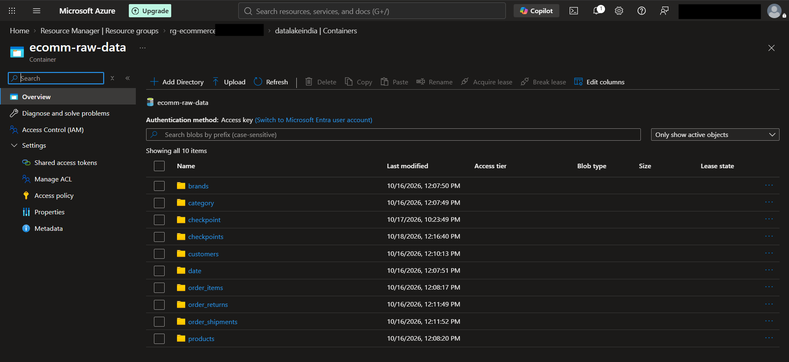
  <br>
  <em>Figure 2: Azure Data Lake Storage Gen2 container (ecomm-raw-data) with landing folders and streaming checkpoints.</em>
</p>

### Folder Hierarchy

| Folder Path | Purpose | Ingestion Mode |
| :--- | :--- | :--- |
| `brands/` | Brand reference data | Batch Overwrite |
| `category/` | Product categories | Batch Overwrite |
| `customers/` | Customer master data | Batch Overwrite |
| `date/` | Fiscal and Gregorian calendar reference | Batch Overwrite |
| `order_items/landing/` | Partitioned daily sales order line items | Structured Streaming (Auto Loader) |
| `order_returns/landing/` | Customer return records | Batch Append / Merge |
| `order_shipments/landing/` | Carrier shipping and delivery events | Batch Append / Merge |
| `checkpoint/` | Streaming checkpoint directories for Bronze, Silver, and Gold | Engine Managed |

---

## 🛡️ Unity Catalog & Governance

The platform utilizes **Databricks Unity Catalog** to manage access control, metadata auditing, lineage, and external storage credentials through an Azure Managed Identity connector.

<p align="center">
  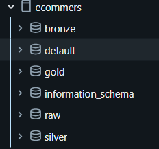
  <br>
  <em>Figure 3: Unity Catalog namespace hierarchy for catalog 'ecommers' showing raw, bronze, silver, and gold schemas.</em>
</p>

### Three-Level Namespace (`ecommers`)

```
ecommers (Catalog)
├── raw (Schema)
│   └── raw_landing (External Volume -> abfss://ecomm-raw-data@datalakeindia.dfs.core.windows.net/)
├── bronze (Schema)
│   ├── brz_brands
│   ├── brz_category
│   ├── brz_products
│   ├── brz_customers
│   ├── brz_calendar
│   └── brz_order_items
├── silver (Schema)
│   ├── slv_brands
│   ├── slv_category
│   ├── slv_products
│   ├── slv_customers
│   ├── slv_calendar
│   └── slv_order_items (Change Data Feed Enabled)
└── gold (Schema)
    ├── gld_dim_products
    ├── gld_dim_customers
    ├── gld_dim_date
    ├── gld_fact_order_items
    └── gld_fact_daily_orders_summary (Auto-Clustered)
```

---

## 🔐 Security, Identity & Access Management

Data governance follows the **Principle of Least Privilege (PoLP)** managed through Azure Entra ID and Databricks Identity and Access.

### 1. Azure Entra ID User Provisioning
Users are provisioned centrally under the organization's tenant directory in Microsoft Azure:

<p align="center">
  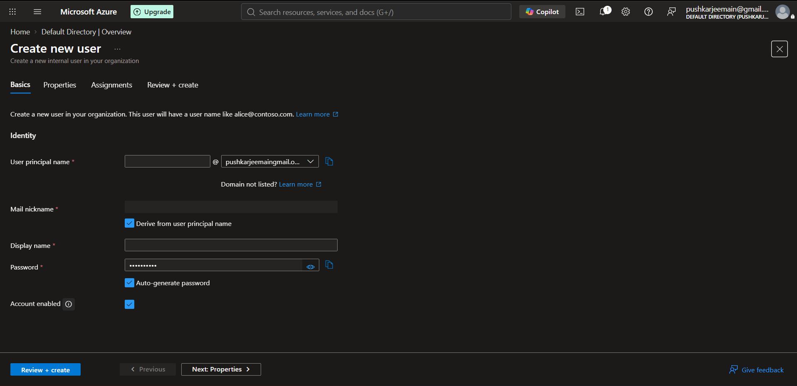
  <br>
  <em>Figure 4: Creating new organizational users in Microsoft Azure Portal (Entra ID).</em>
</p>

### 2. Role-Based Identity Distribution
Users are categorized into functional personas (Data Analysts & Data Engineers):

<p align="center">
  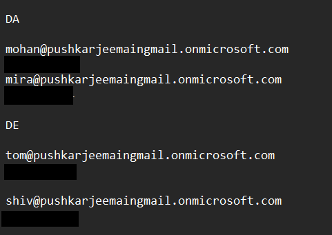
  <br>
  <em>Figure 5: Functional personas: Data Analysts (DA: Mohan & Mira) and Data Engineers (DE: Tom & Shiv).</em>
</p>

### 3. Databricks Workspace Synchronization & Group Policies
Personas are synced into the Databricks workspace and bound to granular workspace groups:

<p align="center">
  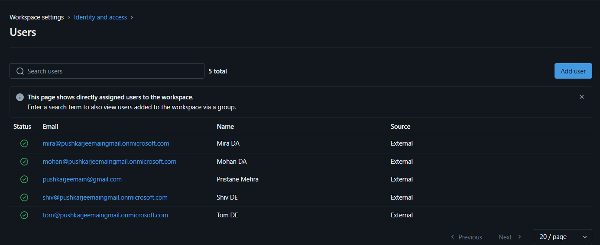
  <br>
  <em>Figure 6: Synced workspace user directory in Databricks Workspace Settings.</em>
</p>

<p align="center">
  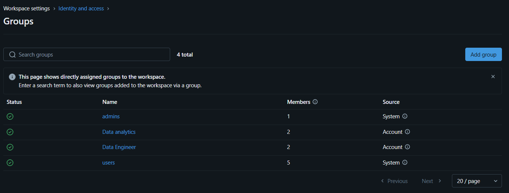
  <br>
  <em>Figure 7: Role-Based Access Control (RBAC) groups configured in Databricks.</em>
</p>

| User Group | Assigned Role | Permissions |
| :--- | :--- | :--- |
| `admins` | Platform Administrator | Full workspace administration, storage credentials, catalog ownership |
| `Data Engineer` | Data Pipeline Developers | DDL/DML on `raw`, `bronze`, and `silver` schemas; workflow management |
| `Data analytics` | BI Analysts & Reporting | `SELECT` and `USAGE` access on `gold` schema and Serverless SQL Warehouse |
| `users` | Standard Organization Users | Read-only access to published reports |

---

## 🔄 Medallion Architecture Processing

### 1. Raw & External Volume Setup

Unity Catalog manages cloud storage securely without access keys embedded in code:

```sql
-- Catalog Creation
CREATE CATALOG IF NOT EXISTS ecommers 
MANAGED LOCATION 'abfss://uc-data@datalakeindia.dfs.core.windows.net/ecommerce-catalog';

USE CATALOG ecommers;
CREATE SCHEMA IF NOT EXISTS raw;
CREATE SCHEMA IF NOT EXISTS bronze;
CREATE SCHEMA IF NOT EXISTS silver;
CREATE SCHEMA IF NOT EXISTS gold;

-- External Volume pointing to ADLS Gen2 Landing Zone
CREATE EXTERNAL VOLUME IF NOT EXISTS raw.raw_landing
LOCATION 'abfss://ecomm-raw-data@datalakeindia.dfs.core.windows.net/'
COMMENT "Reference to raw ADLS Gen2 landing container";
```

---

### 2. Bronze Layer (Raw Ingestion)

The Bronze layer ingests raw CSV feeds as faithfully as possible while capturing audit metadata.

#### Dimension Tables (`1_dim_bronze.ipynb`)
- Explicit schemas defined using PySpark `StructType`.
- Appends audit columns:
  - `_source_file`: Ingested file path (`_metadata.file_path`).
  - `_ingested_at` / `ingest_timestamp`: Capture timestamp (`current_timestamp()`).
- Stored as Delta tables in `ecommers.bronze.*`.

#### Fact Tables (`1_fact_bronze.ipynb`)
- Employs **Databricks Auto Loader** (`cloudFiles`) to process continuous daily files:
  ```python
  spark.readStream \
      .format("cloudFiles") \
      .option("cloudFiles.format", "csv") \
      .option("cloudFiles.schemaLocation", bronze_checkpoint_path) \
      .option("cloudFiles.schemaEvolutionMode", "rescue") \
      .option("header", "true") \
      .option("cloudFiles.inferColumnTypes", "true") \
      .option("rescuedDataColumn", "_rescued_data") \
      .load(adls_path) \
      .withColumn("ingest_timestamp", F.current_timestamp()) \
      .withColumn("source_file", F.col("_metadata.file_path")) \
      .writeStream \
      .outputMode("append") \
      .option("checkpointLocation", bronze_checkpoint_path) \
      .trigger(availableNow=True) \
      .toTable(f"{catalog_name}.bronze.brz_order_items") \
      .awaitTermination()
  ```

---

### 3. Silver Layer (Cleansing, Harmonization & CDF)

The Silver layer enforces quality constraints, cleans anomalies, standardizes schema types, and maintains change history.

#### Dimension Cleansing (`2_dim_silver.ipynb`)
- **Brands (`slv_brands`)**:
  - Regex replacement of non-alphanumeric characters: `F.regexp_replace(col("brand_code"), "[^a-zA-Z0-9]", "")`.
  - Resolves domain inconsistencies:
    ```python
    anomalies = {"GROCERY": "GRCY", "BOOKS": "BKS", "TOYS": "TOY"}
    df_silver = df_silver.replace(to_replace=anomalies, subset=["category_code"])
    ```
- **Categories (`slv_category`)**: Standardizes casing with `upper(trim(col("category_code")))`.
- **Products (`slv_products`)**:
  - Drops rows where `category_code` is `NULL`.
  - Normalizes apparel sizes: converts `"ONE-SIZE"` to `"OS"`.
  - Cleans weight string metric anomalies: strips `"g"` or `"G"` and casts to `FloatType`.
  - Imputes missing colors with `"Unknown"`.
- **Customers (`slv_customers`)**:
  - Enforces mandatory `customer_id` (drops nulls).
  - Imputes missing categorical string fields with `"Unknown"`.
- **Calendar (`slv_calendar`)**:
  - Normalizes day names to uppercase.
  - Rectifies negative week numbers using `abs(col("week_of_year"))` and validates against `expected_week_of_year`.
  - Deduplicates records across calendar keys.

#### Streaming Upsert & Change Data Feed (`2_fact_silver.ipynb`)
- Cleans incoming order line items:
  - Deduplicates on composite key `(order_id, item_seq)`.
  - Fixes text quantity values (e.g., converts string `"Two"` to integer `2`).
  - Strips dollar symbols (`$`) from unit price and percent signs (`%`) from discount values.
  - Normalizes sales channels (`web` → `"Website"`, `app` → `"Mobile"`).
- Enables **Change Data Feed**:
  ```sql
  ALTER TABLE ecommers.silver.slv_order_items SET TBLPROPERTIES (delta.enableChangeDataFeed = true);
  ```
- Executes continuous idempotent merge via `foreachBatch`:
  ```python
  def upsert_to_silver(microBatchDF, batchId):
      table_name = f"{catalog_name}.silver.slv_order_items"
      if not spark.catalog.tableExists(table_name):
          microBatchDF.write.format("delta").mode("overwrite").saveAsTable(table_name)
          spark.sql(f"ALTER TABLE {table_name} SET TBLPROPERTIES (delta.enableChangeDataFeed = true)")
      else:
          deltaTable = DeltaTable.forName(spark, table_name)
          deltaTable.alias("silver_table").merge(
              microBatchDF.alias("batch_table"),
              "silver_table.order_id = batch_table.order_id AND silver_table.item_seq = batch_table.item_seq"
          ).whenMatchedUpdateAll().whenNotMatchedInsertAll().execute()
  ```

---

### 4. Gold Layer (Star Schema & Business Aggregations)

The Gold layer structures data into an optimized dimensional model for enterprise consumption.

#### Dimensions (`3_dim_gold.ipynb`)
- **`gld_dim_products`**:
  - Denormalized view joining products, brands, and categories.
  - Missing brand or category descriptions are coalesced to `'Not Available'`.
- **`gld_dim_customers`**:
  - Enriches customer locations with an international geographic region mapping dictionary:
    - **India**: `MH`, `GJ`, `RJ` (West); `KA`, `TN`, `TS`, `AP`, `KL` (South); `UP`, `WB`, `DL` (North).
    - **Australia**: `VIC` (SouthEast); `WA` (West); `NSW` (East); `QLD` (NorthEast).
    - **United States**: `MA`, `NY`, `NJ` (NorthEast); `CA` (West); `TX`, `FL` (South).
    - **United Kingdom**: `ENG` (England), `SCT` (Scotland), `WLS` (Wales), `NIR` (Northern Ireland).
    - **UAE**, **Singapore**, **Canada**.
  - Default fallback region: `'Other'`.
- **`gld_dim_date`**:
  - Generated integer surrogate key `date_id` (`yyyyMMdd`).
  - Flags weekend activity (`is_weekend = 1` for Saturday/Sunday).
  - Derived attributes: `month_name`, `quarter`, `week_of_year`.

#### Fact Streaming Ingestion via CDF (`3_fact_gold.ipynb`)
Reads incremental changes from `slv_order_items` via Delta Change Data Feed:

```python
silver_incremental_data_df = spark.readStream \
    .format("delta") \
    .option("readChangeFeed", "true") \
    .table(f"{catalog_name}.silver.slv_order_items")

# Filter only actionable rows (Inserts & Post-Update Images)
df_union = silver_incremental_data_df.filter("_change_type IN ('insert', 'update_postimage')")

# KPI & Metric Calculations
df_union = df_union \
    .withColumn("gross_amount", F.col("quantity") * F.col("unit_price")) \
    .withColumn("discount_amount", F.ceil(F.col("gross_amount") * (F.col("discount_pct") / 100.0))) \
    .withColumn("sale_amount", F.col("gross_amount") - F.col("discount_amount") + F.col("tax_amount")) \
    .withColumn("date_id", F.date_format(F.col("dt"), "yyyyMMdd").cast("int")) \
    .withColumn("coupon_flag", F.when(F.col("coupon_code").isNotNull(), F.lit(1)).otherwise(F.lit(0)))
```
Performs streaming upsert into `ecommers.gold.gld_fact_order_items`.

#### Rolling Daily Summary (`Medallion Processing Fact Orders.ipynb`)
Maintains an aggregated order summary table (`gld_fact_daily_orders_summary`) for instant executive reporting:
- Recalculates the last 30 days (`dt >= date_sub(date(max_date), 30)`) to account for retrospective order revisions and late-arriving shipments.
- Calculates `total_quantity`, `total_gross_amount`, `total_discount_amount`, `total_tax_amount`, and `total_amount` grouped by `(date_id, currency)`.
- Applies Delta auto-clustering:
  ```sql
  ALTER TABLE ecommers.gold.gld_fact_daily_orders_summary CLUSTER BY AUTO;
  ```

---

## ⏱️ Workflow Orchestration & DAGs

Workflows are managed through **Databricks Workflows** as decoupled, multi-task Directed Acyclic Graphs (DAGs) on serverless compute.

### Master Daily Pipeline (`daily_job`)
The parent pipeline coordinates dimension updates before fact table processing:

<p align="center">
  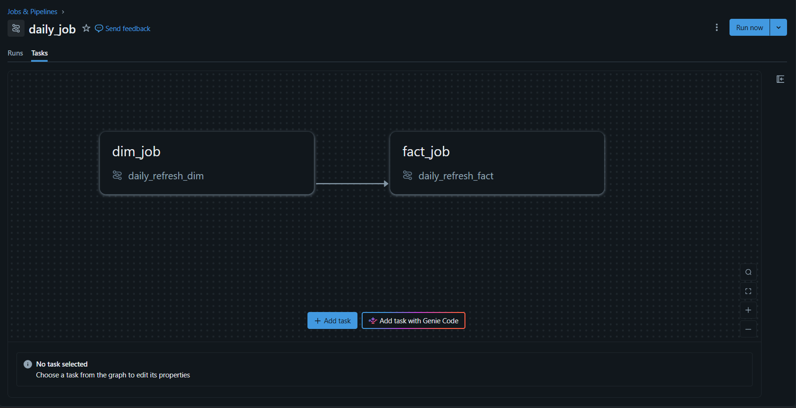
  <br>
  <em>Figure 8: Master workflow DAG ('daily_job') enforcing sequential dependency from 'dim_job' to 'fact_job'.</em>
</p>

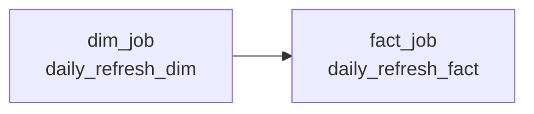

### 1. Dimension Refresh Sub-Job (`daily_refresh_dim`)
Executes sequential tasks across Serverless compute:

<p align="center">
  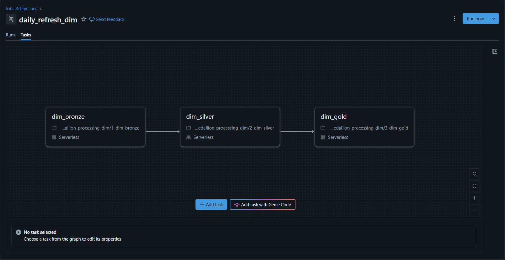
  <br>
  <em>Figure 9: Dimension refresh DAG ('daily_refresh_dim') executing Bronze → Silver → Gold tasks.</em>
</p>

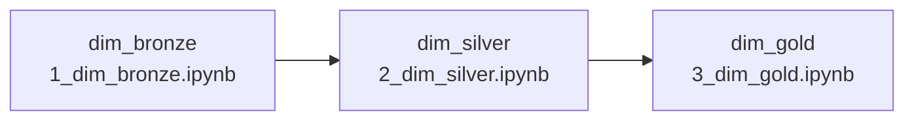

### 2. Fact Refresh Sub-Job (`daily_refresh_fact`)
Executes fact ingestion, streaming micro-batches, and summary updates:

<p align="center">
  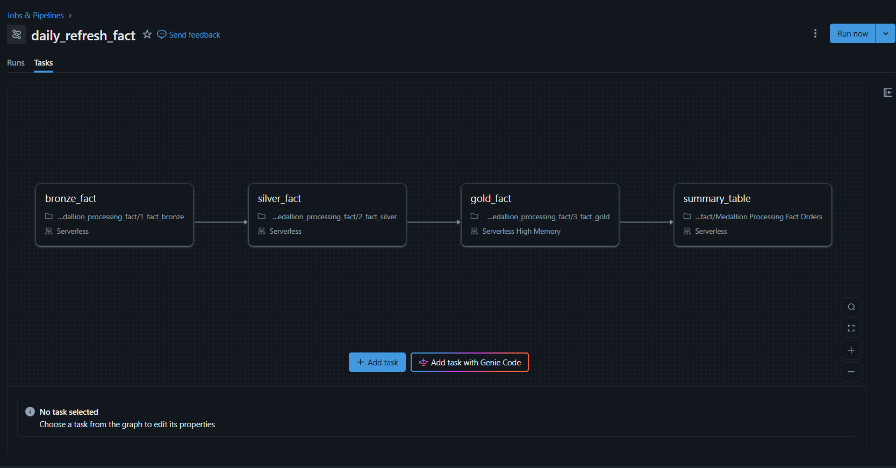
  <br>
  <em>Figure 10: Fact refresh DAG ('daily_refresh_fact') executing Bronze → Silver → Gold → Summary tasks.</em>
</p>

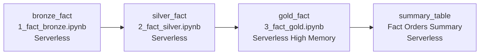

### Automated Schedule & Execution Performance
- Configured with an automated cron trigger running daily at **02:14 AM IST (UTC+05:30)**:
<p align="center">
  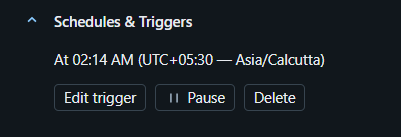
  <br>
  <em>Figure 11: Databricks Automated Schedule & Trigger configured for 02:14 AM IST.</em>
</p>

- Pipeline execution times show consistent, predictable sub-30 minute end-to-end processing across entire historical batches:
<p align="center">
  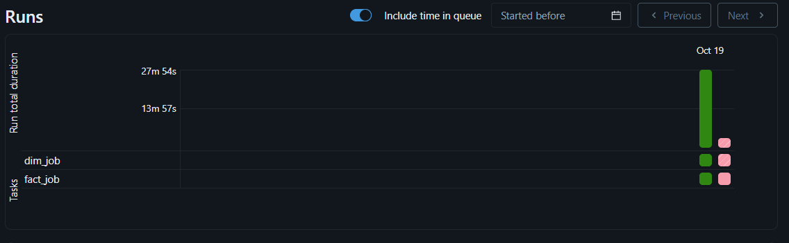
  <br>
  <em>Figure 12: Workflow execution runs showing task durations and completion status.</em>
</p>

---

## 📊 Serving Layer & Power BI Reporting

Analytics queries run directly on Delta tables using Databricks **Serverless SQL Warehouses** over JDBC/ODBC connections.

<p align="center">
  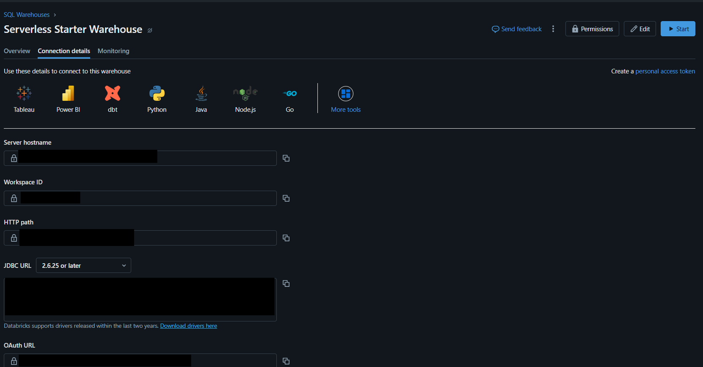
  <br>
  <em>Figure 13: Databricks Serverless Starter SQL Warehouse connection parameters and driver endpoints.</em>
</p>

### Dimensional Data Model (Star Schema)
Power BI connects in **DirectQuery** mode to provide real-time dashboards without caching data locally in the `.pbix` file:

<p align="center">
  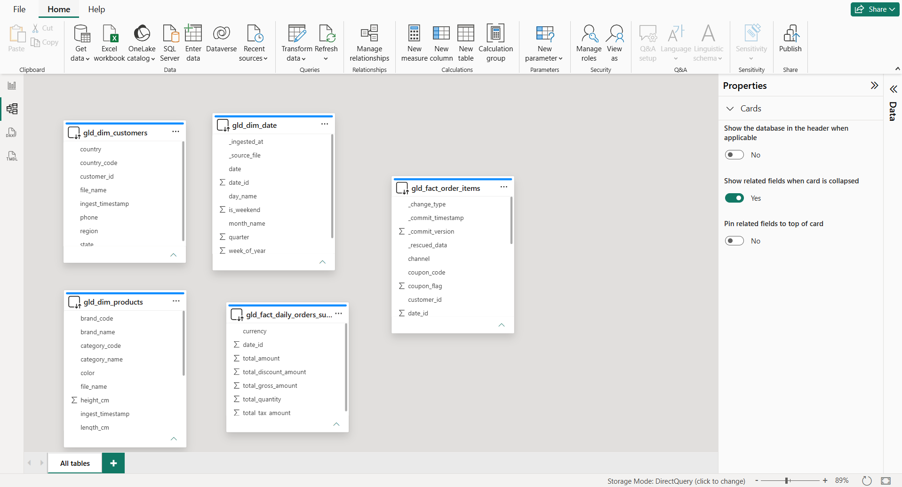
  <br>
  <em>Figure 14: Power BI DirectQuery dimensional model (Star Schema) connecting facts and dimensions.</em>
</p>

#### Star Schema Relationships
- **Fact Tables**:
  - `gld_fact_order_items` (Order line grain)
  - `gld_fact_daily_orders_summary` (Aggregated day & currency grain)
- **Dimension Tables**:
  - `gld_dim_date` (Joined on `date_id`)
  - `gld_dim_customers` (Joined on `customer_id`)
  - `gld_dim_products` (Joined on `product_id`)

The dashboard file is available at [`4_analysis/dashboard.pbix`](./4_analysis/dashboard.pbix).

---

## 📈 Summary Table of Pipeline Data Models

| Layer | Object Name | Type | Ingestion Pattern | Primary / Composite Key |
| :--- | :--- | :--- | :--- | :--- |
| **Raw** | `raw.raw_landing` | External Volume | Filesystem Mount | N/A |
| **Bronze** | `brz_brands` | Delta Table | Batch Overwrite | `brand_code` |
| **Bronze** | `brz_category` | Delta Table | Batch Overwrite | `category_code` |
| **Bronze** | `brz_products` | Delta Table | Batch Overwrite | `product_id` |
| **Bronze** | `brz_customers` | Delta Table | Batch Overwrite | `customer_id` |
| **Bronze** | `brz_calendar` | Delta Table | Batch Overwrite | `date` |
| **Bronze** | `brz_order_items` | Delta Table | Auto Loader Streaming | `(order_id, item_seq)` |
| **Silver** | `slv_brands` | Delta Table | Batch Overwrite | `brand_code` |
| **Silver** | `slv_category` | Delta Table | Batch Overwrite | `category_code` |
| **Silver** | `slv_products` | Delta Table | Batch Overwrite | `product_id` |
| **Silver** | `slv_customers` | Delta Table | Batch Overwrite | `customer_id` |
| **Silver** | `slv_calendar` | Delta Table | Batch Overwrite | `date` |
| **Silver** | `slv_order_items` | Delta Table (CDF) | Streaming Upsert (Merge) | `(order_id, item_seq)` |
| **Gold** | `gld_dim_products` | Delta Table | Batch CTAS / Overwrite | `product_id` |
| **Gold** | `gld_dim_customers` | Delta Table | Batch Overwrite | `customer_id` |
| **Gold** | `gld_dim_date` | Delta Table | Batch Overwrite | `date_id` |
| **Gold** | `gld_fact_order_items` | Delta Table (CDF) | CDF Streaming Merge | `(order_id, item_seq)` |
| **Gold** | `gld_fact_daily_orders_summary` | Delta Table (Auto-Clustered) | Rolling 30-Day Merge | `(date_id, currency)` |

---

## 🚀 Setup & Deployment Guide

### Prerequisites
1. **Microsoft Azure Subscription** with permissions to create Storage Accounts and Managed Identities.
2. **Azure Databricks Workspace** (Premium tier or higher for Unity Catalog).
3. **Power BI Desktop** (for `.pbix` report exploration).

### Step-by-Step Installation

#### 1. Cloud Storage Configuration (ADLS Gen2)
1. Create an Azure Storage Account (ADLS Gen2 enabled), e.g., `datalakeindia`.
2. Create two blob containers:
   - `ecomm-raw-data`: For landing and raw archive datasets.
   - `uc-data`: For Unity Catalog managed table storage.
3. Upload the source data from [`0_data/ecomm-raw-data/historical-full-load/`](./0_data/ecomm-raw-data/historical-full-load/) to `ecomm-raw-data/`.

#### 2. Access Connector & Managed Identity
1. In Azure Portal, create an **Access Connector for Azure Databricks**.
2. Assign the **Storage Blob Data Contributor** role to the connector's managed identity on `datalakeindia`.
3. In Databricks, create a **Storage Credential** linked to the Access Connector resource ID.

#### 3. Unity Catalog Initialization
1. Run [`1_setup/setup_catalog.ipynb`](./1_setup/setup_catalog.ipynb) to create the `ecommers` catalog and schemas (`bronze`, `silver`, `gold`).
2. Run [`1_setup/raw_insert_data.ipynb`](./1_setup/raw_insert_data.ipynb) to create external volume `raw.raw_landing`.

#### 4. Execute Initial Pipeline Load
1. **Dimensions**:
   - Run [`2_medallion_processing_dim/1_dim_bronze.ipynb`](./2_medallion_processing_dim/1_dim_bronze.ipynb)
   - Run [`2_medallion_processing_dim/2_dim_silver.ipynb`](./2_medallion_processing_dim/2_dim_silver.ipynb)
   - Run [`2_medallion_processing_dim/3_dim_gold.ipynb`](./2_medallion_processing_dim/3_dim_gold.ipynb)
2. **Facts**:
   - Run [`3_medallion_processing_fact/1_fact_bronze.ipynb`](./3_medallion_processing_fact/1_fact_bronze.ipynb)
   - Run [`3_medallion_processing_fact/2_fact_silver.ipynb`](./3_medallion_processing_fact/2_fact_silver.ipynb)
   - Run [`3_medallion_processing_fact/3_fact_gold.ipynb`](./3_medallion_processing_fact/3_fact_gold.ipynb)
   - Run [`3_medallion_processing_fact/Medallion Processing Fact Orders.ipynb`](./3_medallion_processing_fact/Medallion%20Processing%20Fact%20Orders.ipynb)

#### 5. Configure Databricks Workflows
1. Create the `daily_refresh_dim` job linking the three dimension notebooks.
2. Create the `daily_refresh_fact` job linking the four fact notebooks.
3. Create the parent `daily_job` DAG configuring `daily_refresh_dim` as an upstream dependency for `daily_refresh_fact`.
4. Set the trigger schedule to **Daily at 02:14 AM IST**.

#### 6. Connect Power BI
1. Launch **Databricks SQL Warehouse** and copy the **Server Hostname** and **HTTP Path** from *Connection details*.
2. Open [`4_analysis/dashboard.pbix`](./4_analysis/dashboard.pbix) in Power BI Desktop.
3. Update data source connection settings with your Databricks endpoint and authenticate via Azure Entra ID / OAuth.

---

## 👤 Author & Maintainer

- **Developer**: Pushkar Mehra
- **Repository**: [Pushkarmehra/Azure-databricks](https://github.com/Pushkarmehra/Azure-databricks)
- **License**: MIT
